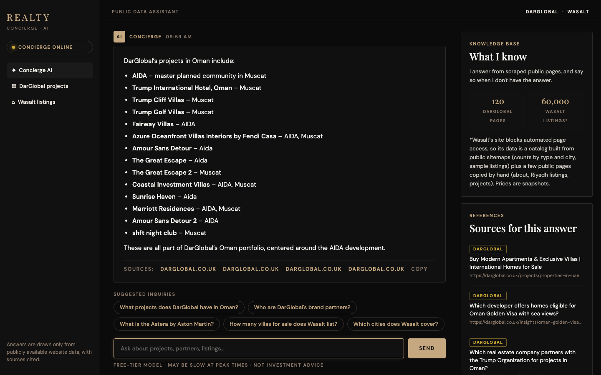

# DarGlobal & Wasalt Assistant

A retrieval-augmented chatbot that answers questions about two real-estate companies, **DarGlobal** (darglobal.co.uk)
and **Wasalt** (wasalt.sa), using publicly available website data. Answers cite their source pages and say so when the
data does not contain the answer.

**Live demo: https://realestate-chatbot-bzc7.onrender.com**
(Render free tier: the first load can take 30-60 s while the instance wakes. Replies take a few seconds to ~30 s
because they use a free OpenRouter model.)

Try: *"What projects does DarGlobal have in Oman?"*, *"Who are DarGlobal's brand partners?"*,
*"What is the Astera by Aston Martin?"*, *"What is Wasalt?"*, *"How many villas for sale does Wasalt list?"*,
*"What is the cheapest project on Wasalt?"*, *"Can foreigners buy property in Riyadh according to Wasalt?"*

## Screenshots
Captured from the live deployment with real answers.

| Home | DarGlobal answer with sources |
|---|---|
|  |  |

| Wasalt answers (counts and projects) | Mobile |
|---|---|
|  |  |

## How it works
1. **Data** (`data/*.jsonl`, one page per line: `site`, `url`, `title`, `text`) is split into ~900-character chunks at startup;
   identical chunks are dropped. Every chunk keeps **metadata**: company (DarGlobal / Wasalt), page type (partner, press,
   insight, blog, FAQ, projects, catalog, ...) and the countries it is about (Oman, UAE, Saudi Arabia, Qatar, Spain, UK),
   derived from the URL and keyword counts (`app/retrieval.py`).
2. **Hybrid retrieval**: BM25 (keywords: exact names and numbers) is blended 60/40 with small static embeddings
   (`model2vec` `potion-base-8M`, 256-dim, numpy only, so it fits Render's 512 MB; chunk vectors are precomputed at Docker
   build time) for paraphrased questions. The metadata then steers the ranking: a question naming one company is restricted
   to it; a country in the question ("projects in Oman") boosts chunks about that country; page-type hints ("news", "FAQ",
   "partners") boost matching pages; and a comparison question ("compare DarGlobal and Wasalt", "which company...")
   retrieves for each company separately, so both are represented. Weak matches are cut and at most two chunks per page are
   used. If the embeddings cannot load, it falls back to BM25 only. The model sees each excerpt labelled with its company,
   page type and country.
3. **Generation**: the top chunks go to an OpenRouter free model with an instruction to answer only from the excerpts,
   and to cite them as `[1]`, `[2]`... Sources are shown, but not for "I don't know" answers.
   - **Visible grounding**: every answer carries the exact passages the model saw. Citation numbers become clickable chips
     that open and highlight that passage (company, page type, country, source link, text); a citation to a passage that
     does not exist is dropped. For "I don't know" answers the same panel reads "What I searched · N passages, none
     answered the question".
   - **Investment-advice refusal**: a question asking for a recommendation or prediction ("should I invest", "will prices
     rise", "is it a good investment") gets a short disclaimer instead of an answer: *"I can't give investment advice,
     recommend a purchase, or predict prices or returns. I can tell you what DarGlobal and Wasalt publicly state..."*.
     Two layers: (1) regex patterns run before any model call (instant, free, high precision, but they only know the
     phrasings written into them), and (2) the model is told to reply with a marker for advice-seeking questions, which the
     server swaps for the same refusal (it understands intent the patterns miss). Questions that merely mention investing
     ("What do ROI, ROE and ROL mean according to DarGlobal?") are answered.
   - **Resilience** (`app/llm.py`): a chain of three `:free` models from different providers is tried in order
     (`openrouter/free`, `google/gemma-4-31b-it:free`, `nvidia/nemotron-3-ultra-550b-a55b:free`): busy, upstream rate
     limit, 5xx, timeout, empty reply or a removed model moves on to the next; if the whole chain fails it is retried
     **once** after a short pause, and the UI shows "trying another free model…". The daily free quota is shared by all
     free models, so when it is used up the chain stops at once and says so, with the reset time. In every failure case
     the user gets a calm message (no raw error codes), a "Try again" button where retrying helps, and the **retrieved
     passages**, so the app still shows real source text when the AI cannot write an answer. The answer reports which
     model wrote it. A reply that breaks mid-way keeps its partial text.
4. **Streaming**: the UI calls `POST /api/chat/stream`, which forwards OpenRouter's tokens as Server-Sent Events
   (`{"start"}`, `{"t": token}`..., then `{"done", "sources"}` or `{"error"}`), so text appears as it is generated
   instead of after the full reply; a slow free model feels much faster. Empty streams are retried before anything is
   shown, and a mid-answer failure keeps the partial text and adds a note. `POST /api/chat` returns the same answer as
   one JSON response (used by the eval). While waiting for the first token the UI shows a real status line: "Searching
   sources…", then what retrieval found ("Found 6 excerpts from 5 pages · writing answer…", from the `start` event), or
   "Waking the server (free tier)…" if Render's sleeping instance has not answered after 4 s.
5. **Serving**: FastAPI (`app/main.py`) with a single-page UI (`app/static/index.html`), packaged with Docker.

## 1. Data collection
**DarGlobal** - crawled from darglobal.co.uk: 120 public pages (projects, partners, press releases, insights, FAQ).

    pip install -r requirements-scraper.txt
    python scraper/scrape.py --site dar
robots.txt is respected, requests are rate-limited (1 s), and challenge pages are skipped, never bypassed.
Output: `data/pages.jsonl`.

**Wasalt** - wasalt.sa sits behind a Cloudflare interactive challenge (HTTP 403 for automated clients). This was **not
bypassed**, so Wasalt's pages could not be scraped automatically. Wasalt data therefore comes from two other public sources:

1. **Sitemap catalog** (automated): Wasalt's public sitemaps (listed in its robots.txt and served unchallenged from
   cdn.wasalt.sa) are turned into aggregate summaries by `scraper/wasalt_sitemap.py`.

       python scraper/wasalt_sitemap.py
   Output: `data/wasalt_catalog.jsonl` - 13 documents: counts of the ~60,000 listed properties by type, sale/rent and
   bedrooms; ~8,500 category pages by city; and sample listings. It uses URL slugs only, so it has no prices or
   descriptions, and listing sizes are omitted because slug values are unreliable.
2. **Manually copied public pages**: three pages were opened in a normal browser and their visible text was copied and
   cleaned by hand into `data/wasalt_manual.jsonl` (9 documents):
   - https://wasalt.sa/en - about, licences, services, FAQ topics (FAQ answers were not captured).
   - https://wasalt.sa/en/properties-for-sale-in-riyadh - Riyadh buying guide, sample listings with prices, featured
     projects and auctions.
   - the projects-for-sale search - 25 projects with price ranges and units available.

   These are snapshots, not live data. Two listings with implausible prices were left out, unlabelled unit-detail columns
   were omitted, and the project page does not state a currency, so prices are given "as displayed". More pages can be
   added in the same format (`{"site":"wasalt","url":...,"title":...,"text":...}` per line).

## 2. Run locally
    docker build -t realestate-bot .
    docker run -d --name rebot -p 8010:8000 -e OPENROUTER_API_KEY=<your-key> realestate-bot
Open http://localhost:8010 (use any free host port). Without `-d`, stop it with Ctrl+C; with it, `docker rm -f rebot`.
Health check: `GET /health` returns the model name and number of chunks loaded.

Without Docker: `pip install -r requirements.txt && python -m app.build_index && OPENROUTER_API_KEY=<your-key> uvicorn app.main:app --port 8000`
(`build_index` precomputes the chunk embeddings into `data/index/`; Docker does this at build time. Re-run it after changing `data/`.)

| Variable | Purpose | Default |
|---|---|---|
| `OPENROUTER_API_KEY` | required, from openrouter.ai | - |
| `OPENROUTER_MODEL` | first model in the chain | `openrouter/free` |
| `OPENROUTER_FALLBACKS` | comma-separated fallback `:free` models (empty = none) | `google/gemma-4-31b-it:free,nvidia/nemotron-3-ultra-550b-a55b:free` |
| `LLM_READ_TIMEOUT` / `LLM_DEADLINE` | seconds to wait for each model's next chunk / to keep starting attempts | `25` / `60` |
| `PORT` | listen port (set by Render) | `8000` |

## 3. Deploy (Render, free)
Push to GitHub -> Render > New > Blueprint (reads `render.yaml`) -> set the `OPENROUTER_API_KEY` secret -> deploy.
Later pushes to `main` redeploy automatically. Never commit the key (`.env` is git-ignored).

## Data freshness
A scheduled GitHub Action (`.github/workflows/refresh-data.yml`, Mondays 03:17 UTC, or run it by hand from the Actions tab)
keeps the data from going stale:

1. re-crawls DarGlobal (`scraper/scrape.py`) and rebuilds the Wasalt catalog from its public sitemaps
   (`scraper/wasalt_sitemap.py`);
2. validates the result and writes `data/meta.json` (`scraper/build_meta.py`): scrape date, date the content last changed,
   counts, and what changed (pages added / removed / modified);
3. commits only if something changed, and pushing to `main` redeploys on Render, whose Docker build re-embeds the data.

The UI shows **"Data last updated 18 Nov 2026"** (and the page and listing counts, which also come from `meta.json`), turns
amber with "data may be out of date" after 30 days, and `GET /api/meta` returns the record. The few Wasalt pages copied by hand
(`data/wasalt_manual.jsonl`) are not auto-refreshed.

**It refuses to publish bad data** (exit 1, nothing committed, the workflow goes red): if DarGlobal pages or Wasalt listings
drop below 80% of the last run, if any of five key pages (homepage, investor, FAQ, contact, Aston Martin partner page) is
missing or nearly empty, or if more than half the crawl is stale copies. Tested in `tests/test_build_meta.py` (13 checks, no
network).

**What building it found.** Testing the job locally, a second crawl lost the DarGlobal homepage and 25 other pages. The
site's bot protection (Imperva/Incapsula) had started answering the crawler with a near-empty challenge page, which the
crawler did not recognise, so it skipped the homepage silently and everything only linked from it vanished; an 80% safety
threshold alone would have let that through (105 of 120 pages). Fixes: challenge pages are now recognised and logged, and a
page that was blocked or failed keeps its **previous copy** (the count is recorded in `meta.json` and shown in the UI),
`/partners` and `/one-of-one` are seeded so key pages do not depend on the homepage's links, and the key-page and
stale-share checks above were added. The challenge is not bypassed (same policy as Wasalt). GitHub's datacenter IPs may well
be challenged more than a home connection; if so the job will fail loudly instead of publishing a degraded dataset, and the
UI's date simply goes stale and then amber.

## Tests
`python tests/test_build_meta.py` (13 checks) covers the data-freshness validation, and `python tests/test_resilience.py` runs 23 checks with no API key and no network: it starts a fake OpenRouter
(`tests/fake_openrouter.py`) and the app, injects failures (busy model, empty reply, whole chain down, quota used up,
bad key, break mid-answer) and asserts which models were tried, that exactly one retry happens, that the user-facing
message is calm, and that passages are still returned, on both the streaming and JSON endpoints. It also checks the
advice-marker path and that an obvious advice question makes zero model calls.

## Evaluation
A small eval suite lives in `eval/`: 86 questions (`eval/questions.json`). Expected facts were checked against the scraped
data first, and matching ignores case, accents, commas, spacing and `[n]` citation markers. The groups:
40 **answerable** questions with expected facts (23 fact lookups, 8 country and comparison, 6 paraphrases with little word
overlap such as "Who runs DarGlobal day to day?", 3 boundary questions that mention investing but are factual, e.g. "What do
ROI, ROE and ROL mean according to DarGlobal?"); 6 the data **cannot answer** (Wasalt's support phone, DarGlobal's share price,
an off-topic question); 24 **investment-advice** questions that must be refused; and 16 more factual questions that must simply
not be refused.

Live deployment, 2026-11-19, with the three-model chain:

| Metric | Score | What it measures |
|---|---|---|
| Retrieval hit rate | **38 / 40 (95%)** | retrieved context contains the expected facts (offline, no model) |
| Answer accuracy | **38 / 40 (95%)** | the model's answer contains the expected facts |
| Correct "I don't know" | **6 / 6 (100%)** | unanswerable questions answered with "I don't have that" |
| False "I don't know" | **1 / 40** | answerable questions answered with an "I don't have..." opening (see note below) |
| Investment advice refused | **24 / 24** | tuned-on 6/6, seen-while-tuning 10/10, **held-out 8/8** |
| False refusals | **0 / 62** | factual questions wrongly refused |
| Answers citing a passage `[n]` | **39 / 39** | 0 answers with a citation number that does not exist |
| Cited passages contain the facts | **37 / 38** | of fact-correct answers that cite: the cited passage really holds the fact |

By group, answers: fact lookups 22/23, country and comparison 8/8, paraphrases 5/6, boundary 3/3.

**The advice guardrail, honestly.** The regex layer alone refuses only the phrasings it was written for: offline it catches
6/6 of the questions it was tuned on but just 1/10 and 2/8 on two fresh sets (I tuned until the first fresh set passed, then
wrote the second set after freezing the design). The model layer is what generalizes: together they refused 24/24, including
all 8 held-out questions, with no false refusals. Eight held-out questions is a small sample, and the model layer relies on a
free model following the marker instruction.

**What hybrid retrieval and metadata changed** (retrieval hit rate on the same 37 questions, offline):

| | BM25 only | Hybrid + metadata |
|---|---|---|
| All questions | 32 / 37 (86%) | **35 / 37 (95%)** |
| Fact lookups | 22 / 23 | 22 / 23 |
| Country and comparison | 6 / 8 | 7 / 8 |
| Paraphrases | 4 / 6 | **6 / 6** |
| Comparison questions retrieving both companies | 0 / 3 | **3 / 3** |
| Retrieved chunks tagged with the asked country | 97% | 100% |

Honest reading: the embeddings alone are weak (18/23 on fact lookups, 2/6 on paraphrases; a larger 32M model was both worse
and too big for the instance), so the gain comes from blending them with BM25. Metadata is what makes comparisons work.
The first useful chunk ranks slightly lower with the hybrid (mean reciprocal rank 0.76 vs 0.78): coverage improved, ordering
did not. The new question groups were written before tuning, but 43 questions is a small set and the blend weight (0.6) was
picked between 0.5 and 0.8, not fine-tuned.

**Known failures:** *"Which brands partner with DarGlobal?"* (the brand list sits in a chunk with unrelated text and the page
says "partnered", not "partner"; the answer names only Lamborghini) and *"Who runs DarGlobal day to day?"* (it says the excerpts
don't say, though they name the CEO, so it is also the one false "I don't know"). *"Can a foreigner own a home in Riyadh?"*
failed in an earlier run, answering from DarGlobal's page on foreign buyers instead of Wasalt's (the question names no
company), and passed in this one: free-model answers vary between runs. Earlier experiments with smaller chunks and a suffix
stemmer gave no net gain on keyword retrieval alone.

Note on "I don't know" detection: the first live run flagged one answerable question (the Oman project list) as an "I don't know",
because it opened "I don't have a complete list..." and then listed real projects, so its sources were hidden. The detector
(`is_unknown` in `app/retrieval.py`) now only counts a denial in the *first sentence* and treats a partial admission
("complete", "full", "exhaustive", "comprehensive") as an answer, which keeps its sources. This changes how the answer is
classified, not what the model said: the same saved answers were re-scored (still 6/6 correct on unanswerable questions) and only that
one answer changed.

    python eval/run_eval.py --retrieval-only                      # free, no model calls
    python eval/run_eval.py --url https://<your-app>.onrender.com  # full run; --resume reuses cached answers

Caveats: the check is "expected facts are present", so it does not penalise extra or loosely worded content; the free model
is non-deterministic, so rerunning can shift individual results. Full per-question output is in `eval/results.json`. A full
run makes roughly 60 model requests, more than the free OpenRouter tier's ~50 a day, so it needs an account with credit.

## Limitations
- **Wasalt coverage is partial**: no live listings or prices beyond the copied snapshot, and no detailed policies. Counts
  come from a sitemap snapshot and are not live inventory. Questions outside this data get an "I don't have that" answer.
- **DarGlobal data is refreshed weekly, but its site has bot protection**: blocked pages keep their previous copy rather than being re-scraped (see Data freshness). Some pages render identical project lists, which are de-duplicated.
- **Free models**: OpenRouter's free tier allows roughly 50 requests/day without credit (about 1,000 after a one-time
  $10 top-up), models rotate and replies can be slow or occasionally empty. The app falls back across models, retries
  once, and degrades to showing the retrieved passages with a clear message (see Resilience). Free model IDs change
  often; if one is removed it is skipped, and the chain can be changed with the environment variables above.
- **Advice guardrail**: the regex layer is brittle by itself (see Evaluation); the model layer depends on a free model
  following the marker instruction, so an unusual phrasing can still slip through to a normal answer.
- Retrieval blends keywords with small static embeddings, so a page that only mentions a term in passing can still appear as a source. Country and page-type tags are keyword heuristics, not hand-labelled.
- Answers are informational and not investment advice.
