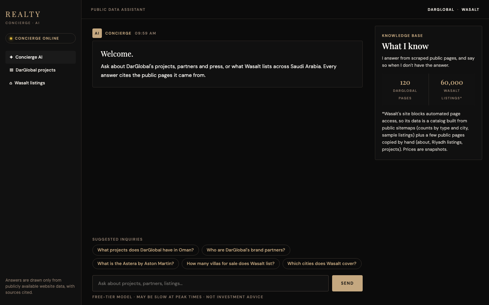
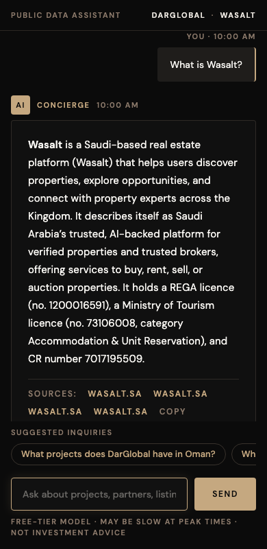

# DarGlobal & Wasalt Assistant

A retrieval-augmented chatbot that answers questions about two real-estate companies, **DarGlobal** (darglobal.co.uk)
and **Wasalt** (wasalt.sa), using publicly available website data. Answers cite their source pages and say so when the
data does not contain the answer.

**Live demo: https://realestate-chatbot-bzc7.onrender.com**
(Render free tier: the first load can take 30-60 s while the instance wakes. Replies take a few seconds to ~30 s
because they use a free OpenRouter model.)

Try: *"What projects does DarGlobal have in Oman?"*, *"Who are DarGlobal's brand partners?"*,
*"What is the Astera by Aston Martin?"*, *"What is Wasalt?"*, *"How many villas for sale does Wasalt list?"*,
*"What is the cheapest project on Wasalt?"*, *"Can foreigners buy property in Riyadh according to Wasalt?"*

## Screenshots
Captured from the live deployment with real answers.

| Home | DarGlobal answer with sources |
|---|---|
|  |  |

| Wasalt answers (counts and projects) | Mobile |
|---|---|
|  |  |

## How it works
1. **Data** (`data/*.jsonl`, one page per line: `site`, `url`, `title`, `text`) is split into ~900-character chunks at startup;
   identical chunks are dropped.
2. **Retrieval** is BM25 over chunk title + URL words + text. Filler words are ignored, a question naming only one company
   is restricted to that company's data, weak matches are cut, and at most two chunks per page are used.
3. **Generation**: the top chunks go to an OpenRouter free model (`openrouter/free`) with an instruction to answer only from
   the excerpts. Sources are shown, but not for "I don't know" answers.
4. **Streaming**: the UI calls `POST /api/chat/stream`, which forwards OpenRouter's tokens as Server-Sent Events
   (`{"start"}`, `{"t": token}`..., then `{"done", "sources"}` or `{"error"}`), so text appears as it is generated
   instead of after the full reply; a slow free model feels much faster. Empty streams are retried before anything is
   shown, and a mid-answer failure keeps the partial text and adds a note. `POST /api/chat` returns the same answer as
   one JSON response (used by the eval).
5. **Serving**: FastAPI (`app/main.py`) with a single-page UI (`app/static/index.html`), packaged with Docker.

## 1. Data collection
**DarGlobal** - crawled from darglobal.co.uk: 120 public pages (projects, partners, press releases, insights, FAQ).

    pip install -r requirements-scraper.txt
    python scraper/scrape.py --site dar
robots.txt is respected, requests are rate-limited (1 s), and challenge pages are skipped, never bypassed.
Output: `data/pages.jsonl`.

**Wasalt** - wasalt.sa sits behind a Cloudflare interactive challenge (HTTP 403 for automated clients). This was **not
bypassed**, so Wasalt's pages could not be scraped automatically. Wasalt data therefore comes from two other public sources:

1. **Sitemap catalog** (automated): Wasalt's public sitemaps (listed in its robots.txt and served unchallenged from
   cdn.wasalt.sa) are turned into aggregate summaries by `scraper/wasalt_sitemap.py`.

       python scraper/wasalt_sitemap.py
   Output: `data/wasalt_catalog.jsonl` - 13 documents: counts of the ~60,000 listed properties by type, sale/rent and
   bedrooms; ~8,500 category pages by city; and sample listings. It uses URL slugs only, so it has no prices or
   descriptions, and listing sizes are omitted because slug values are unreliable.
2. **Manually copied public pages**: three pages were opened in a normal browser and their visible text was copied and
   cleaned by hand into `data/wasalt_manual.jsonl` (9 documents):
   - https://wasalt.sa/en - about, licences, services, FAQ topics (FAQ answers were not captured).
   - https://wasalt.sa/en/properties-for-sale-in-riyadh - Riyadh buying guide, sample listings with prices, featured
     projects and auctions.
   - the projects-for-sale search - 25 projects with price ranges and units available.

   These are snapshots, not live data. Two listings with implausible prices were left out, unlabelled unit-detail columns
   were omitted, and the project page does not state a currency, so prices are given "as displayed". More pages can be
   added in the same format (`{"site":"wasalt","url":...,"title":...,"text":...}` per line).

## 2. Run locally
    docker build -t realestate-bot .
    docker run -d --name rebot -p 8010:8000 -e OPENROUTER_API_KEY=<your-key> realestate-bot
Open http://localhost:8010 (use any free host port). Without `-d`, stop it with Ctrl+C; with it, `docker rm -f rebot`.
Health check: `GET /health` returns the model name and number of chunks loaded.

Without Docker: `pip install -r requirements.txt && OPENROUTER_API_KEY=<your-key> uvicorn app.main:app --port 8000`.

| Variable | Purpose | Default |
|---|---|---|
| `OPENROUTER_API_KEY` | required, from openrouter.ai | - |
| `OPENROUTER_MODEL` | model ID | `openrouter/free` |
| `OPENROUTER_FALLBACKS` | comma-separated extra `:free` model IDs | none |
| `PORT` | listen port (set by Render) | `8000` |

## 3. Deploy (Render, free)
Push to GitHub -> Render > New > Blueprint (reads `render.yaml`) -> set the `OPENROUTER_API_KEY` secret -> deploy.
Later pushes to `main` redeploy automatically. Never commit the key (`.env` is git-ignored).

## Evaluation
A small eval suite lives in `eval/`: 29 questions with expected facts (`eval/questions.json`; 13 DarGlobal, 10 Wasalt, and
6 the data cannot answer, e.g. Wasalt's support phone number, DarGlobal's share price, an off-topic question). Expected facts
were checked against the scraped data first, and matching ignores case, accents, commas and spacing.

| Metric | Score | What it measures |
|---|---|---|
| Retrieval hit rate | **22 / 23 (96%)** | retrieved context contains the expected facts (offline, no model) |
| Answer accuracy | **22 / 23 (96%)** | the model's answer contains the expected facts |
| Correct "I don't know" | **6 / 6 (100%)** | unanswerable questions answered with "I don't have that", and no sources shown |
| False "I don't know" | **0 / 23** | answerable questions where the bot wrongly gave up |

Run against the live deployment on 2026-11-19 with `openrouter/free`.
The one failure is *"Which brands partner with DarGlobal?"*: the full brand list sits in a long chunk on the investor page
that keyword (BM25) retrieval ranks too low, so the answer names only Lamborghini and Paramount. It is left as a known
limitation (retrieval was not tuned to the test set). Chunk sizes (300-900 characters, sentence-level splits) and a suffix
stemmer were tried; none beat 22/23, each fix just moved the miss to another question (e.g. the Riyadh phone number), so the
settings were left unchanged. A real fix would need embedding-based or hybrid retrieval.

    python eval/run_eval.py --retrieval-only                      # free, no model calls
    python eval/run_eval.py --url https://<your-app>.onrender.com  # full run; --resume reuses cached answers

Caveats: 29 questions is a small set; the check is "expected facts are present", so it does not penalise extra or
loosely worded content (e.g. an answer that quotes two different Wasalt counts still passes if the right one is there);
and the free model is non-deterministic, so rerunning can shift individual results. Full per-question output is in
`eval/results.json`. The free OpenRouter tier (~50 requests/day) is too small for a full run unless the account has credit.

## Limitations
- **Wasalt coverage is partial**: no live listings or prices beyond the copied snapshot, and no detailed policies. Counts
  come from a sitemap snapshot and are not live inventory. Questions outside this data get an "I don't have that" answer.
- **DarGlobal data is a point-in-time crawl**; some pages render identical project lists, which are de-duplicated.
- **Free model**: OpenRouter's free tier allows roughly 50 requests/day without credit, models rotate, and replies can be
  slow or occasionally empty (the app retries). Errors show the real OpenRouter status code (429 = daily limit,
  401 = bad key, 402 = no credits).
- Retrieval is keyword-based (BM25), so a page that only mentions a term in passing can still appear as a source.
- Answers are informational and not investment advice.
