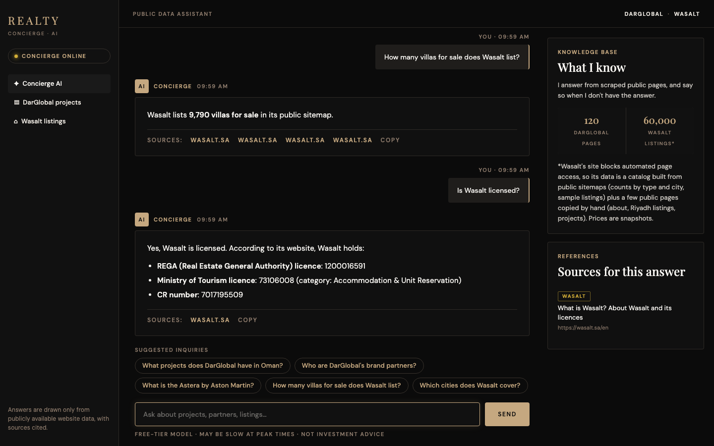

# DarGlobal & Wasalt Assistant

A retrieval-augmented chatbot that answers questions about two real-estate companies, **DarGlobal** (darglobal.co.uk)
and **Wasalt** (wasalt.sa), using publicly available website data. Answers cite their source pages and say so when the
data does not contain the answer.

**Live demo: https://realestate-chatbot-bzc7.onrender.com**
(Render free tier: the first load can take 30-60 s while the instance wakes. Replies take a few seconds to ~30 s
because they use a free OpenRouter model.)

Try: *"What projects does DarGlobal have in Oman?"*, *"Who are DarGlobal's brand partners?"*,
*"What is the Astera by Aston Martin?"*, *"What is Wasalt?"*, *"How many villas for sale does Wasalt list?"*,
*"What is the cheapest project on Wasalt?"*, *"Can foreigners buy property in Riyadh according to Wasalt?"*

## Screenshots
Captured from the live deployment with real answers.

| Home | DarGlobal answer with sources |
|---|---|
|  |  |

| Wasalt answers (counts and projects) | Mobile |
|---|---|
|  |  |

## How it works
1. **Data** (`data/*.jsonl`, one page per line: `site`, `url`, `title`, `text`) is split into ~900-character chunks at startup;
   identical chunks are dropped. Every chunk keeps **metadata**: company (DarGlobal / Wasalt), page type (partner, press,
   insight, blog, FAQ, projects, catalog, ...) and the countries it is about (Oman, UAE, Saudi Arabia, Qatar, Spain, UK),
   derived from the URL and keyword counts (`app/retrieval.py`).
2. **Hybrid retrieval**: BM25 (keywords: exact names and numbers) is blended 60/40 with small static embeddings
   (`model2vec` `potion-base-8M`, 256-dim, numpy only, so it fits Render's 512 MB; chunk vectors are precomputed at Docker
   build time) for paraphrased questions. The metadata then steers the ranking: a question naming one company is restricted
   to it; a country in the question ("projects in Oman") boosts chunks about that country; page-type hints ("news", "FAQ",
   "partners") boost matching pages; and a comparison question ("compare DarGlobal and Wasalt", "which company...")
   retrieves for each company separately, so both are represented. Weak matches are cut and at most two chunks per page are
   used. If the embeddings cannot load, it falls back to BM25 only. The model sees each excerpt labelled with its company,
   page type and country.
3. **Generation**: the top chunks go to an OpenRouter free model (`openrouter/free`) with an instruction to answer only from
   the excerpts. Sources are shown, but not for "I don't know" answers.
4. **Streaming**: the UI calls `POST /api/chat/stream`, which forwards OpenRouter's tokens as Server-Sent Events
   (`{"start"}`, `{"t": token}`..., then `{"done", "sources"}` or `{"error"}`), so text appears as it is generated
   instead of after the full reply; a slow free model feels much faster. Empty streams are retried before anything is
   shown, and a mid-answer failure keeps the partial text and adds a note. `POST /api/chat` returns the same answer as
   one JSON response (used by the eval). While waiting for the first token the UI shows a real status line: "Searching
   sources…", then what retrieval found ("Found 6 excerpts from 5 pages · writing answer…", from the `start` event), or
   "Waking the server (free tier)…" if Render's sleeping instance has not answered after 4 s.
5. **Serving**: FastAPI (`app/main.py`) with a single-page UI (`app/static/index.html`), packaged with Docker.

## 1. Data collection
**DarGlobal** - crawled from darglobal.co.uk: 120 public pages (projects, partners, press releases, insights, FAQ).

    pip install -r requirements-scraper.txt
    python scraper/scrape.py --site dar
robots.txt is respected, requests are rate-limited (1 s), and challenge pages are skipped, never bypassed.
Output: `data/pages.jsonl`.

**Wasalt** - wasalt.sa sits behind a Cloudflare interactive challenge (HTTP 403 for automated clients). This was **not
bypassed**, so Wasalt's pages could not be scraped automatically. Wasalt data therefore comes from two other public sources:

1. **Sitemap catalog** (automated): Wasalt's public sitemaps (listed in its robots.txt and served unchallenged from
   cdn.wasalt.sa) are turned into aggregate summaries by `scraper/wasalt_sitemap.py`.

       python scraper/wasalt_sitemap.py
   Output: `data/wasalt_catalog.jsonl` - 13 documents: counts of the ~60,000 listed properties by type, sale/rent and
   bedrooms; ~8,500 category pages by city; and sample listings. It uses URL slugs only, so it has no prices or
   descriptions, and listing sizes are omitted because slug values are unreliable.
2. **Manually copied public pages**: three pages were opened in a normal browser and their visible text was copied and
   cleaned by hand into `data/wasalt_manual.jsonl` (9 documents):
   - https://wasalt.sa/en - about, licences, services, FAQ topics (FAQ answers were not captured).
   - https://wasalt.sa/en/properties-for-sale-in-riyadh - Riyadh buying guide, sample listings with prices, featured
     projects and auctions.
   - the projects-for-sale search - 25 projects with price ranges and units available.

   These are snapshots, not live data. Two listings with implausible prices were left out, unlabelled unit-detail columns
   were omitted, and the project page does not state a currency, so prices are given "as displayed". More pages can be
   added in the same format (`{"site":"wasalt","url":...,"title":...,"text":...}` per line).

## 2. Run locally
    docker build -t realestate-bot .
    docker run -d --name rebot -p 8010:8000 -e OPENROUTER_API_KEY=<your-key> realestate-bot
Open http://localhost:8010 (use any free host port). Without `-d`, stop it with Ctrl+C; with it, `docker rm -f rebot`.
Health check: `GET /health` returns the model name and number of chunks loaded.

Without Docker: `pip install -r requirements.txt && python -m app.build_index && OPENROUTER_API_KEY=<your-key> uvicorn app.main:app --port 8000`
(`build_index` precomputes the chunk embeddings into `data/index/`; Docker does this at build time. Re-run it after changing `data/`.)

| Variable | Purpose | Default |
|---|---|---|
| `OPENROUTER_API_KEY` | required, from openrouter.ai | - |
| `OPENROUTER_MODEL` | model ID | `openrouter/free` |
| `OPENROUTER_FALLBACKS` | comma-separated extra `:free` model IDs | none |
| `PORT` | listen port (set by Render) | `8000` |

## 3. Deploy (Render, free)
Push to GitHub -> Render > New > Blueprint (reads `render.yaml`) -> set the `OPENROUTER_API_KEY` secret -> deploy.
Later pushes to `main` redeploy automatically. Never commit the key (`.env` is git-ignored).

## Evaluation
A small eval suite lives in `eval/`: 43 questions with expected facts (`eval/questions.json`). Expected facts were checked
against the scraped data first, and matching ignores case, accents, commas and spacing. The questions come in groups:
23 **fact lookups** (13 DarGlobal, 10 Wasalt), 8 **country and comparison** questions ("List DarGlobal's projects in Oman",
"Compare DarGlobal and Wasalt"), 6 **paraphrases** with little word overlap ("Who runs DarGlobal day to day?"), and 6 the
data **cannot answer** (Wasalt's support phone, DarGlobal's share price, an off-topic question).

Live deployment, 2026-11-19, `openrouter/free`:

| Metric | Score | What it measures |
|---|---|---|
| Retrieval hit rate | **35 / 37 (95%)** | retrieved context contains the expected facts (offline, no model) |
| Answer accuracy | **35 / 37 (95%)** | the model's answer contains the expected facts |
| Correct "I don't know" | **6 / 6 (100%)** | unanswerable questions answered with "I don't have that", and no sources shown |
| False "I don't know" | **0 / 37** | answerable questions answered with an "I don't have..." opening (see note below) |

By group, answers: fact lookups 22/23, country and comparison 8/8, paraphrases 5/6.

**What hybrid retrieval and metadata changed** (retrieval hit rate on the same 37 questions, offline):

| | BM25 only | Hybrid + metadata |
|---|---|---|
| All questions | 32 / 37 (86%) | **35 / 37 (95%)** |
| Fact lookups | 22 / 23 | 22 / 23 |
| Country and comparison | 6 / 8 | 7 / 8 |
| Paraphrases | 4 / 6 | **6 / 6** |
| Comparison questions retrieving both companies | 0 / 3 | **3 / 3** |
| Retrieved chunks tagged with the asked country | 97% | 100% |

Honest reading: the embeddings alone are weak (18/23 on fact lookups, 2/6 on paraphrases; a larger 32M model was both worse
and too big for the instance), so the gain comes from blending them with BM25. Metadata is what makes comparisons work.
The first useful chunk ranks slightly lower with the hybrid (mean reciprocal rank 0.76 vs 0.78): coverage improved, ordering
did not. The new question groups were written before tuning, but 43 questions is a small set and the blend weight (0.6) was
picked between 0.5 and 0.8, not fine-tuned.

**Known failures:** *"Which brands partner with DarGlobal?"* (the brand list sits in a chunk with unrelated text and the page
says "partnered", not "partner"; the answer names only Lamborghini and says "12+ partners"), and *"Can a foreigner own a home
in Riyadh?"*, which names no company, so the bot answered from DarGlobal's page on foreign buyers instead of Wasalt's (the
expected fact was Wasalt's 3,000 sqm limit; arguably an ambiguous question). One more: *"Who runs DarGlobal day to day?"* says the excerpts don't say,
though they name the CEO. Earlier experiments with smaller chunks and a suffix stemmer gave no net gain on keyword retrieval alone.

Note on "I don't know" detection: the first live run flagged one answerable question (the Oman project list) as an "I don't know",
because it opened "I don't have a complete list..." and then listed real projects, so its sources were hidden. The detector
(`is_unknown` in `app/retrieval.py`) now only counts a denial in the *first sentence* and treats a partial admission
("complete", "full", "exhaustive", "comprehensive") as an answer, which keeps its sources. This changes how the answer is
classified, not what the model said: the same saved answers were re-scored (0/37 false "I don't know", still 6/6 correct on
unanswerable questions) and only that one answer changed.

    python eval/run_eval.py --retrieval-only                      # free, no model calls
    python eval/run_eval.py --url https://<your-app>.onrender.com  # full run; --resume reuses cached answers

Caveats: the check is "expected facts are present", so it does not penalise extra or loosely worded content; the free model
is non-deterministic, so rerunning can shift individual results. Full per-question output is in `eval/results.json`. The
free OpenRouter tier (~50 requests/day) is too small for a full run unless the account has credit.

## Limitations
- **Wasalt coverage is partial**: no live listings or prices beyond the copied snapshot, and no detailed policies. Counts
  come from a sitemap snapshot and are not live inventory. Questions outside this data get an "I don't have that" answer.
- **DarGlobal data is a point-in-time crawl**; some pages render identical project lists, which are de-duplicated.
- **Free model**: OpenRouter's free tier allows roughly 50 requests/day without credit, models rotate, and replies can be
  slow or occasionally empty (the app retries). Errors show the real OpenRouter status code (429 = daily limit,
  401 = bad key, 402 = no credits).
- Retrieval blends keywords with small static embeddings, so a page that only mentions a term in passing can still appear as a source. Country and page-type tags are keyword heuristics, not hand-labelled.
- Answers are informational and not investment advice.
