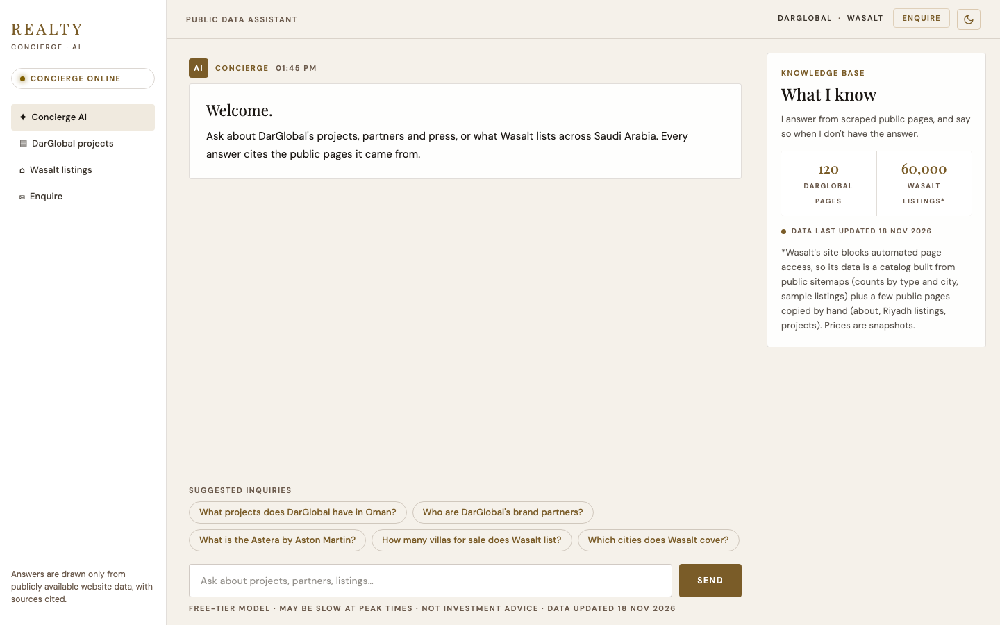
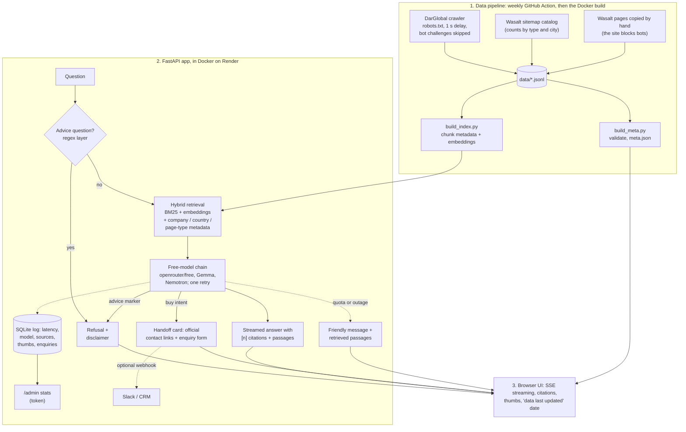

# DarGlobal & Wasalt Assistant

[](https://github.com/Vaibhavee89/Realstate-Chatbot/actions/workflows/ci.yml)

**[▶ Watch the 60-second demo](docs/demo.mp4)** · **[Live app](https://realestate-chatbot-bzc7.onrender.com)**
*(Render free tier: the first load can take 30–60 s while the instance wakes, and answers take 3–40 s because they come
from free OpenRouter models.)*

[](docs/demo.mp4)

A retrieval-augmented chatbot that answers questions about two real-estate companies, **DarGlobal** (darglobal.co.uk) and
**Wasalt** (wasalt.sa), from their public web pages. Every answer streams in, cites the passages it came from (click a
citation to read the passage), and says "I don't have that" when the data does not contain the answer. It is not run by
either company.

> **Read this first: Wasalt blocks bots.** wasalt.sa answers automated requests with a Cloudflare challenge, which I did
> not try to defeat. Wasalt's data is therefore thinner than DarGlobal's: a catalog built from its public sitemaps plus
> three pages copied by hand from a normal browser. [What I did and what it costs](#the-wasalt-problem-and-what-i-did-about-it).

*How the video was made:* it is an automated recording, not a hand-driven capture. A script (`scripts/record_demo.py`)
drives a real browser against the live app, so the answers are real. The free model can take 10–40 s to start answering, so
only the wait before the first word is sped up, and the video says so on screen while it plays; typing, streaming and
clicks run at real speed. The enquiry form is filled with obviously fake data.

The UI has a **dark and a light theme**: it follows your system setting, the header button switches, and the choice is
remembered.

| Dark | Light |
|---|---|
|  |  |

**Try:** *What projects does DarGlobal have in Oman?* · *Compare DarGlobal and Wasalt: what does each company do?* ·
*How many villas for sale does Wasalt list?* · *What is the cheapest project on Wasalt?* · *Should I invest in AIDA?*
(it declines) · *I want to buy a villa in Muscat* (it offers a next step).

## Architecture



**Life of a question.**
1. A regex layer refuses obvious investment-advice questions before any model call (instant, free).
2. Retrieval scores every chunk with **BM25** (exact names and numbers) blended 60/40 with **small static embeddings**
   (paraphrases), then uses **metadata** on each chunk (company, page type, country): a question naming one company is
   restricted to it, a country in the question boosts chunks about it, and a comparison retrieves from each company
   separately. At most two chunks per page; weak matches are cut.
3. The top chunks, labelled with their company, page type and country, go to a **chain of three free models**; the first
   that answers wins. The model is told to answer only from the excerpts and to cite them as `[1]`, `[2]`.
4. The reply streams to the browser over Server-Sent Events. The server holds back the first few characters to catch two
   markers the model may start with: one for advice-seeking questions (swapped for the refusal), one for buying intent
   (adds the handoff card).
5. Citations become clickable chips that open the exact passage; each answer has thumbs up/down. One row per question
   (latency, model, sources, outcome, rating) goes to SQLite.

| Path | What it is |
|---|---|
| `app/main.py` | FastAPI routes: chat (streaming + JSON), feedback, enquiry form, admin, data metadata |
| `app/retrieval.py` | chunking, chunk metadata, BM25 + embeddings, metadata-aware ranking |
| `app/llm.py` | the model chain, retry, quota handling, streaming |
| `app/guard.py`, `app/handoff.py` | advice refusal and buy-intent detection (regex layer; the model layer is in `main.py`) |
| `app/store.py` | SQLite: chat log, thumbs, enquiries |
| `app/static/` | the single-page UI and the admin page |
| `scraper/` | DarGlobal crawler, Wasalt sitemap catalog, data validation (`build_meta.py`) |
| `data/` | scraped pages, Wasalt catalog, hand-copied Wasalt pages, `meta.json` |
| `tests/`, `eval/`, `scripts/` | tests, the 108-question eval, the container smoke test and the demo recorder |
| `docs/` | [evaluation](docs/EVALUATION.md), [operations](docs/OPERATIONS.md), screenshots, the demo video |

## The Wasalt problem, and what I did about it

**What happens.** Every page on wasalt.sa answers an automated request (`curl`, Python `requests`) with HTTP 403 and a
Cloudflare "Just a moment…" interactive challenge. A headless Chromium run timed out on every page rather than getting
through. Its `robots.txt` is open (`Allow: /`, only `/search` disallowed), so crawling is not forbidden there, but the
challenge is an explicit gate on automated visitors.

**What I decided.** I did **not** try to get past it: no stealth browser, no challenge-solving service, no rotating
proxies. A challenge page is a clear signal that bots are unwelcome, circumventing it is the kind of thing that gets a
project (and the person running it) in trouble, and a pipeline built on evading a security product would break the day
Cloudflare updates it. I have not read Wasalt's terms of service, so I make no claim beyond that.

**What I did instead,** in order of how much data it gives:
1. **Public sitemaps.** `robots.txt` lists sitemaps on `cdn.wasalt.sa`, which are not behind the challenge. They list
   about 60,000 property listings and 8,500 search/category pages. `scraper/wasalt_sitemap.py` turns the *URLs only* into
   13 summary documents: counts by property type, sale/rent, bedrooms and city, plus sample listings. No page content is
   fetched, so there are no prices or descriptions, and the sizes embedded in listing URLs are unreliable, so I left them out.
2. **Three public pages copied by hand** from a normal browser session (the home page, the Riyadh for-sale page and the
   projects-for-sale search) and cleaned into 9 documents: what Wasalt says it is, its licences, services, a buying guide for
   Riyadh, sample listings with prices, and 25 off-plan projects with price ranges. Snapshots, not live data.
3. **Disclosure.** The UI states how the Wasalt data was gathered and shows when it was last updated; the bot says "I don't
   have that" for anything outside this data (the eval includes such questions, e.g. Wasalt's support phone number).

**What it costs.** No live listings or prices beyond the hand-copied snapshot; counts come from a sitemap snapshot and are
not live inventory; the FAQ answers were not captured; the project page does not state a currency, so prices are given "as
displayed"; and the hand-copied pages are not refreshed by the weekly job. **A proper fix is Wasalt's cooperation**: a data
feed, an API, or written permission to crawl.

DarGlobal is also behind bot protection (Imperva): during testing it started answering my crawler with a challenge page
mid-session. I handled it the same way (see [Data freshness](docs/OPERATIONS.md#data-freshness)): never bypassed, blocked
pages keep their previous copy, and the weekly job refuses to publish a degraded dataset.

## Design decisions, and why

| Decision | Why | What it costs |
|---|---|---|
| **Retrieval over scraped pages; answer only from the excerpts; cite them** | Keeps answers tied to sources a reader can check, and lets the bot say "I don't know" | Less fluent than a model answering from memory; only as good as the scrape |
| **BM25 + small static embeddings (`model2vec` 8M), not a big embedding model or a vector database** | The questions are full of exact names and numbers (BM25 wins), but paraphrases need meaning. 650 chunks and a 512 MB free instance do not justify a vector DB. Measured: embeddings alone 18/23 on fact lookups, BM25 alone 4/6 on paraphrases, blended 22/23 and 6/6 | A tiny model: weak on its own, only useful blended |
| **Chunk metadata: company, page type, country** | Makes "projects in Oman" and "compare the two companies" work; comparison questions went from 0/3 to 3/3 retrieving both companies | Country tags are keyword heuristics, not hand labels |
| **Free OpenRouter models, in a chain of three with one retry** | Zero cost, and different providers rarely fail together | Latency 3–40 s, ~50 requests/day without credit, model IDs churn, quality varies |
| **When the model is unavailable, show the retrieved passages and a calm message** | A reviewer who hits a rate limit should not think the app is broken, and the passages are real source text | The user reads sources instead of a summary |
| **SSE streaming with a real status line** | A slow free model feels much faster when words appear as they arrive and the wait says what it is doing | A bit more server and client code |
| **Investment advice: regex first, then a model marker** | The regex is free and instant but only knows its phrasings (measured: caught 2 of 8 fresh ones); the model understands intent (refused 8 of 8 fresh ones live) | Depends on a free model following an instruction |
| **Handoff to the companies' own contact pages, plus a demo-owned enquiry form** | A real-estate bot should hand buyers on, but this bot is not DarGlobal's or Wasalt's, so the form says plainly that details stay with the demo | Leads do not reach the companies; a production bot would post to their CRM |
| **SQLite for logs and enquiries, plus an optional webhook** | Simple, queryable, no extra service | Render's free disk is wiped on every deploy; the webhook (or a persistent disk) is how leads survive |
| **A weekly refresh job that refuses to publish bad data** | Stale data should be visible, and a half-failed scrape must not wipe good data | It may fail loudly when bot protection blocks GitHub's runners |
| **Embeddings built into the Docker image at build time** | No download or compute at start-up, works offline, starts in about a second | A 545 MB image, and the build needs network once |
| **An eval with held-out questions, reported honestly** | Regex guards looked perfect on the questions I wrote them against and failed on fresh ones; without held-out sets I would not have known | 108 questions is small and I wrote them |

## Evaluation

108 questions with expected facts, run against the live deployment (details, per-group numbers and failures in
[docs/EVALUATION.md](docs/EVALUATION.md)):

| | Result |
|---|---|
| Answers containing the expected facts | **38 / 40 (95%)** |
| Retrieval hit rate (offline, no model) | **38 / 40 (95%)** |
| Correct "I don't know" on unanswerable questions | **6 / 6** |
| Investment advice refused (including **8 held-out**) | **24 / 24**, with **0 / 62** false refusals |
| Buy intent shows the handoff card (**held-out 5 / 8**) | **11 / 14**, with **0 / 24** false cards |
| Answers that cite a real passage | **39 / 39**; the cited passage holds the fact in **37 / 38** |

The two failures are *"Which brands partner with DarGlobal?"* (the brand list sits in a chunk with unrelated text) and
*"Who runs DarGlobal day to day?"*. Hybrid retrieval raised the retrieval hit rate from 86% to 95% on the same questions.
The regex layers alone caught only 2 of 8 fresh advice questions and 0 of 8 fresh buy-intent ones; the model layer is what
generalizes.

## Known limitations

- **Wasalt data is thin and a snapshot** (see above): no live listings, no prices beyond hand-copied pages, FAQ answers
  missing, hand-copied pages never refreshed.
- **DarGlobal's site also has bot protection.** The weekly refresh may be blocked from GitHub's servers; blocked pages keep
  their previous copy and a mostly-blocked crawl fails the job instead of publishing. The crawl is capped at 120 pages.
- **Free models are slow and variable**: 3–40 s to answer, roughly 50 requests/day without credit, free model IDs change,
  and the same question can get differently worded answers. The chain and the fallback to passages soften this; they do not
  remove it. Cold starts on Render's free tier take 30–60 s.
- **Retrieval is keyword plus a tiny embedding model.** It misses answers buried in long lists and vague comparisons ("what
  does each company do?"), and a page that mentions a term in passing can still be cited.
- **Guardrails are two layers, neither perfect.** The regex layers are brittle (above); the model layers depend on a free
  model following an instruction, so an unusual phrasing can slip through (3 of 8 fresh buy-intent phrasings missed).
  Each held-out set has only 8 questions.
- **The eval is small and mine.** I wrote the questions; matching checks that the expected facts are present, not that
  every other word is right; numbers come from one run of a non-deterministic model; there is no human evaluation.
  `docs/EVALUATION.md` lists every failure.
- **Scraped text is untrusted input to the model.** A page that contained instructions could try to steer it. I have not
  tested prompt injection, and the markers are handled server-side but a hostile page could still try to trigger them.
- **Enquiries stay with this demo** and are not sent to either company (the UI says so). Render's free disk is wiped on
  every deploy; set `LEAD_WEBHOOK_URL` or attach a disk to keep them. Questions are logged as text (switchable with
  `LOG_QUESTIONS=0`), there is no retention policy, and none of this is a GDPR-compliance claim.
- **Small-instance security only**: one admin token, an in-memory rate limiter, no authentication on the chat.
- **English only.** Arabic project names are shown as they appear on the page, untranslated; the UI has no Arabic mode.
- **No license file yet**, so by default all rights are reserved.

## Run it

```bash
docker build -t realestate-bot .
docker run -d --name rebot -p 8010:8000 -e OPENROUTER_API_KEY=<your-key> realestate-bot   # then open http://localhost:8010
```

Without Docker: `pip install -r requirements.txt && python -m app.build_index && OPENROUTER_API_KEY=<key> uvicorn app.main:app --port 8000`
(`build_index` precomputes the chunk embeddings; Docker does it at build time; re-run it after changing `data/`).
Re-scrape with `python scraper/scrape.py --site dar` and `python scraper/wasalt_sitemap.py`.
Deploy: push to GitHub, then Render → New → Blueprint (reads `render.yaml`) and set `OPENROUTER_API_KEY`; later pushes redeploy.

| Variable | Purpose | Default |
|---|---|---|
| `OPENROUTER_API_KEY` | required, from openrouter.ai | none |
| `OPENROUTER_MODEL` | first model in the chain | `openrouter/free` |
| `OPENROUTER_FALLBACKS` | comma-separated fallback `:free` models (empty = none) | `google/gemma-4-31b-it:free,nvidia/nemotron-3-ultra-550b-a55b:free` |
| `LLM_READ_TIMEOUT` / `LLM_DEADLINE` | seconds to wait for each model's next chunk / to keep starting attempts | `25` / `60` |
| `ADMIN_TOKEN` | enables `/admin`, `/admin/stats`, `/admin/leads`, `/admin/leads.csv` (send as `X-Admin-Token`); unset = those routes do not exist | unset |
| `LEAD_WEBHOOK_URL` | also POST every saved enquiry here (Slack-compatible) | unset |
| `DB_PATH` | SQLite file for the chat log and enquiries | `data/app.db` |
| `LOG_QUESTIONS` | `0` = store a hash of each question instead of its text | `1` |
| `PORT` | listen port (set by Render) | `8000` |

How the system behaves when models fail, how the weekly data refresh works, and what is stored about visitors are in
[docs/OPERATIONS.md](docs/OPERATIONS.md).

## Tests and CI

[`ci.yml`](.github/workflows/ci.yml) runs on every push and pull request, in two jobs:

1. **Tests and retrieval gate**: a syntax check, three test suites that start the app against a fake OpenRouter (no API key,
   no network, no quota), then builds the embedding index and **fails if retrieval quality drops below 90%** or a guardrail
   pattern starts firing on factual questions.
2. **Docker**: builds the image from the same `Dockerfile` Render uses, starts it, and smoke-tests it
   (`scripts/smoke_container.sh`): the embeddings are baked in, retrieval works, the advice refusal works, the app degrades
   gracefully when the model is unreachable, enquiries save, the admin token is enforced, and the container is not root.

Locally: `python tests/test_build_meta.py` (13 checks), `python tests/test_resilience.py` (23), `python tests/test_leads_logging.py`
(39), `python eval/run_eval.py --retrieval-only --min-retrieval 0.9`, `scripts/smoke_container.sh <image>`, and (needs Playwright, not in CI) `python tests/test_ui_theme.py`, which checks the theme logic and the WCAG contrast of every visible text element in both themes. The full eval
(`python eval/run_eval.py --url <app>`) needs about 60 model requests, more than the free tier allows per day, so it is not
in CI. A separate scheduled workflow (`refresh-data.yml`) refreshes the data weekly.
